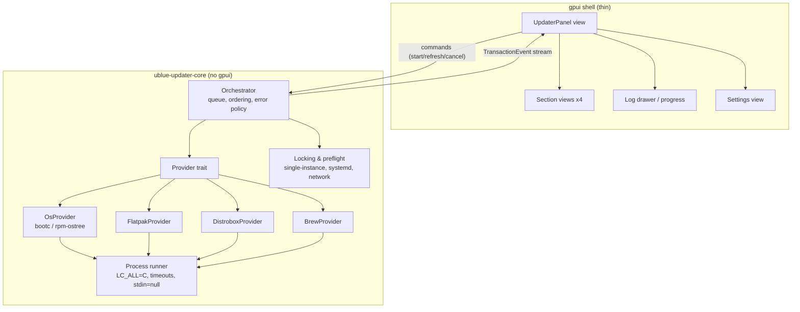

# ublue-updater — Design Document

**Status:** Draft for review — pre-implementation
**Date:** 2026-10-23
**Target:** Universal Blue images (Bluefin, Aurora, Bazzite) and adjacent Fedora Atomic desktops

---

## 1. Summary

`ublue-updater` is a native **Rust desktop application** built with **gpui** (Zed's GPU-accelerated UI framework) that gives Universal Blue users a single, clean panel to:

1. **See** available updates across four domains: **OS (rpm-ostree/bootc), Flatpak, Distrobox, Homebrew**.
2. **Run** updates either **all at once** or **per domain**.
3. Observe **progress, logs, and results** per domain, with honest error reporting.

The design is deliberately split into a **UI-framework-free core** (`ublue-updater-core`) and a **thin gpui shell**. The core owns process spawning, parsing, orchestration, and locking, and is fully testable headless. This isolates us from the two biggest risks in this project: gpui's pre-1.0 API churn, and the fragility of driving four CLI tools with different output formats, privilege models, and transaction semantics.

---

## 2. Goals and non-goals

### Goals

| # | Goal |
|---|------|
| G1 | Single window listing pending updates grouped by domain (OS / Flatpak / Distrobox / Brew), with counts and per-item detail. |
| G2 | Apply updates per domain, or all domains sequentially via one button ("Update everything"). |
| G3 | Live progress (percent when available, status line + streaming log always). |
| G4 | Graceful degradation: hide/disable domains whose tools are absent (no distrobox, no brew, etc.). |
| G5 | Never run the GUI as root; privilege escalation only via session polkit / systemd. |
| G6 | Coexist with existing automation *where present* (uupd timers, rpm-ostreed automatic updates, GNOME Software/PackageKit) instead of racing it. uupd is **not** a dependency; OS updates deliberately use the polkit path (`rpm-ostree upgrade`) to avoid sudoers/passwordless-wheel setups (D6). |
| G7 | Core logic usable headless (library + optional CLI) for CI, debugging, and power users. |

### Non-goals (v1)

- Installing/removing software (updates only).
- Package browsing, search, or "store" features.
- OS rollback UI (`rpm-ostree rollback` / `bootc rollback` — candidate for v2).
- Unattended/scheduled updates — that's the domain of systemd-based tooling (uupd, where installed). We coordinate with such tools when present; we are not one and do not require any.
- Multi-user management of brew/distrobox (they are per-user; we manage the current user's scope only).
- Telemetry of any kind.

---

## 3. Target environment and prior art

### 3.1 What we're running on

- **Immutable base:** Fedora Atomic / OSTree-based images. Important: **Universal Blue is migrating to `bootc`**; the org's own updater ([`ublue-os/uupd`](https://github.com/ublue-os/uupd)) treats **bootc as primary and rpm-ostree as a fallback**. Our OS provider must be an abstraction — *resolved (D6/OQ-6):* **detection and apply both run through rpm-ostree** (`status --json` unprivileged for detection, `upgrade` via polkit for apply); `bootc` requires root for every command, including `status`, so it is unused in v1 (kept behind the trait for future authenticated use).
- **Session:** GNOME or KDE Plasma on Wayland (X11 must still work). **Running a GUI as root is effectively impossible under Wayland** — this single fact shapes the entire privilege model.
- **Tools available on a stock Bluefin:** `rpm-ostree`/`bootc`, `flatpak`, `podman` (+ `distrobox`), `brew` (host-installed, `~/.brew` — OQ-1 resolved), `systemctl`, polkit + an auth agent in mainstream sessions.

### 3.2 Prior art

| Project | Relevance | What we take from it |
|---|---|---|
| `ublue-os/uupd` (Go) | Same four domains, systemd timers, polkit rules, COPR packaging | Coordination rules (§9.3), module-disable config conventions, packaging path |
| `ublue-update` (bash, legacy) | Predecessor; some images still carry its timers | Detection of legacy units to warn about |
| GNOME Software / PackageKit | Reference UX for OS updates + polkit flows | Staged-update / "restart required" UX |
| `flatpak` / `rpm-ostree` DBus APIs | Structured progress signals exist (`org.projectatomic.rpmostree1`, `org.freedesktop.Flatpak` transactions) | Phase-2 upgrade path for progress fidelity (§5, D2) |

**Decision D1 — standalone core, not a uupd frontend.** uupd is a batch updater (Go, no library API, no "list pending updates" command, coarse progress). Our core requirement G1 (browsing updates) isn't covered by it. We implement our own Rust core but *coordinate* with uupd where it is installed (detect its timer, avoid concurrent runs). **Product decision (OQ-4, resolved): no uupd executor, no uupd dependency** — the owner explicitly wants updates on the polkit path (`rpm-ostree upgrade`) rather than uupd's sudo/wheel model.

---

## 4. Architecture

### 4.1 Overview



### 4.2 Workspace layout

Convert the repo to a Cargo workspace (the existing `ublue-updater` crate becomes the GUI binary):

```
ublue-updater/            # workspace root
├── Design.md
├── Cargo.toml            # [workspace]
├── crates/
│   ├── core/             # ublue-updater-core: domain model, providers, orchestrator
│   ├── cli/              # ublue-updater-cli (optional, headless debug binary, phase M1)
│   └── gui/              # ublue-updater: gpui app (bin name: ublue-updater)
└── assets/               # icon, .desktop file, metainfo
```

**Decision D2 — CLI subprocessing with JSON output for phase 1; DBus (zbus) for rpm-ostree/Flatpak progress in phase 2.**
Shelling out is pragmatic: it matches exactly what the tools document, needs no root DBus code, and works everywhere. Where a tool emits machine-readable output we use it (`rpm-ostree status --json`, `brew outdated --json=v2`); elsewhere we parse plain text with `LC_ALL=C` and fixture tests (§13). The cost is progress fidelity, which we fix later for the two tools that have real transaction APIs.

---

## 5. Domain model (core)

```rust
pub enum Domain { Os, Flatpak, Distrobox, Brew }

pub enum Availability {
    Ready { version: Option<String> },
    Absent,                 // tool not installed -> hide section
    Broken { reason: String }, // installed but unusable (e.g. podman denied)
}

pub struct UpdateItem {
    pub id: ItemId,                    // stable key (e.g. "flatpak:system:org.mozilla.firefox")
    pub name: String,
    pub current: Option<String>,      // current version, if known
    pub target: Option<String>,       // target version, if known
    pub size: Option<u64>,            // download size, if known
    pub pinned: bool,                 // excluded from selection (flatpak pin, hold, etc.)
}

pub struct UpdateSet { pub items: Vec<UpdateItem> }

pub enum TransactionEvent {
    Started { label: String },
    Progress { percent: Option<u8>, message: String }, // percent None => indeterminate
    ItemStarted { id: ItemId },
    ItemFinished { id: ItemId, ok: bool },
    LogLine(String),                                    // raw tool output, timestamped
    Finished { outcome: Outcome },
}

pub enum Outcome { Success, Partial { failures: Vec<Failure> }, Failed { reason: String }, Cancelled }

#[async_trait::async_trait]
pub trait UpdateProvider: Send + Sync {
    fn domain(&self) -> Domain;
    async fn detect(&self) -> Availability;                 // cheap, no network
    async fn refresh(&self) -> Result<(), ProviderError>;  // fetch metadata (network)
    async fn list_updates(&self) -> Result<UpdateSet, ProviderError>;
    async fn apply(&self, selection: &[ItemId], events: EventSink) -> Outcome;
    async fn cancel(&self); // best-effort (SIGTERM child + cleanup where safe)
}
```

Notes:

- `EventSink` is a bounded async channel (`async-channel`); the GUI drains it on gpui's background executor and forwards batches into entity state, so UI updates are batched and never block the child processes.
- `Outcome::Partial` is a first-class result: Flatpak and Brew routinely have per-item failures while others succeed. The UI must render this honestly, not as a generic "error".

### 5.1 Orchestration semantics ("Update everything")

**Decision D3 — "all at once" means a strictly sequential queue, never parallel fan-out.**
Rationale (details in §11): rpm-ostreed allows one system transaction; the flatpak system-helper serializes system installs; concurrent `brew` invocations are unsafe. (Brew is host-installed on Bluefin — OQ-1 resolved — so there is no brew↔distrobox container coupling; the order below is kept because it is deterministic and ends on the reboot-prompting OS step.) Parallelism buys nothing but lock errors.

Order:

1. **Flatpak** (user install first, then system).
2. **Distrobox** (all containers, or selected).
3. **Brew** (host-installed, per OQ-1 — no container interplay).
4. **OS (bootc/rpm-ostree) last** — it only *stages* a deployment for the next boot, doesn't disturb the running session, and ending on it makes the natural finale: "Restart to finish updating".

Error policy: **continue on failure by default** (one domain failing must not block the others), each domain's outcome recorded independently; a summary report ends the run. Cancellation stops the current child process at a safe boundary and skips remaining queue entries (never kills rpm-ostree/bootc mid-transaction unless the user explicitly confirms; see §11-E5).

---

## 6. Providers (phase-1 concrete plan)

| Domain | Detect | Refresh | List pending | Apply | Progress source |
|---|---|---|---|---|---|
| **OS — rpm-ostree** (detection **and** apply — the only path usable unprivileged) | `rpm-ostree` in PATH | `rpm-ostree refresh-md` | `rpm-ostree status --json` (booted/staged deployments, `cached-update` — §6.1) | `rpm-ostree upgrade` (polkit — D6) | status/progress lines ("Receiving objects…"); phase 2: DBus `Progress` signal |
| **OS — bootc** | present on bootc-managed hosts | **not used in v1** — requires root for every command, including `status` (OQ-6 resolved) | — (v2 authenticated-enrichment path, §6.1) | — | — |
| **Flatpak** | `flatpak` in PATH | (implicit in remote-ls) | `flatpak remote-ls --updates` for `--user` and `--system` | `flatpak update --noninteractive --assumeyes` per installation (both flags together — OQ-5 resolved), targeted refs where selected | `Installing x/y` lines → percent; per-ref item events |
| **Distrobox** | `distrobox` + `podman\|docker` in PATH | none (n/a) | **not cheaply knowable** — see §11-D7 | `distrobox upgrade --all` or per-container `distrobox upgrade -n <name>` | per-container status lines; indeterminate percent |
| **Brew** | `brew` in PATH (host `~/.brew` on Bluefin — OQ-1 resolved; tolerate containerized setups on custom images) | `brew update` (with `HOMEBREW_NO_AUTO_UPDATE=1` everywhere else) | `brew outdated --json=v2` | `brew upgrade [<formula>...]` | coarse, line-based |

Cross-cutting process rules (all providers):

- `LC_ALL=C` (and `TZ=UTC`) in every child environment so parsing is locale-stable.
- `stdin = /dev/null` so nothing can block on an interactive prompt; hard **watchdog timeout** (configurable, generous — OS pulls can exceed 30 min) with a "still working?" UI state rather than a silent kill.
- Every raw line is captured into a per-transaction log buffer (bounded ring, e.g. 10k lines) that the UI can show in a drawer — this is our support/bugreport story.
- Brew environment additionally sets `HOMEBREW_NO_AUTO_UPDATE=1`, `HOMEBREW_NO_ENV_HINTS=1`, `HOMEBREW_NO_INSTALL_CLEANUP=1` for predictable, prompt-free runs.
- Keep a cheap runtime probe for containerized-brew setups on custom images; if one is found, serialize Distrobox↔Brew in the orchestrator (see §11-C3).

### 6.1 OS provider detail — detection via `rpm-ostree status --json`

`bootc` requires root for *every* invocation — including `status` (OQ-6 resolved) — so it is unusable from an unprivileged session GUI and is dropped from v1. Detection and apply both run through rpm-ostree (D6). `rpm-ostree status --json` is readable without privileges and is the detection source of truth:

| JSON concept | Meaning | UI / provider use |
|---|---|---|
| `deployments[]` entry with `"booted": true` | current deployment (version, origin, layered packages) | "current version" line; layered-package count |
| a newer staged deployment (awaiting reboot) | update staged for next boot | **Restart required** banner |
| `cached-update` payload on the booted deployment (container-based images) | newer image pulled & cached | counts as **update available**; apply stages quickly |
| the remaining rollback deployment | previous deployment | v2 rollback UI; never disturb pinned |

Exact key names are pinned from a real fixture captured in M1 (the schema shifts slightly across rpm-ostree versions); parsing stays fixture-driven.

*Deferred to v2 — authenticated bootc enrichment:* after the user authenticates for an OS apply, an optional privileged `bootc status --format=json` call would unlock bootc-only knowledge the rpm-ostree JSON lacks: `softRebootCapable` (offer **Soft restart** / `systemctl soft-reboot`), `rollbackQueued`, and `incompatible` warnings (edge case D9). The already-captured sample (boots `latest.20261015`, `cachedUpdate`+`staged` `latest.20261023`) is retained as the fixture for that path.

---

## 7. Privilege model

**Decision D4 — the GUI never runs as root; it relies on session polkit.**

- **Brew, distrobox (rootless podman), flatpak --user:** no privilege needed at all.
- **OS update (`rpm-ostree upgrade`) and flatpak --system:** the CLI child process talks to a root daemon (`rpm-ostreed`, flatpak system-helper). When an authentication agent is present in the session (GNOME, KDE), a polkit password dialog appears automatically — owned by the agent, not by us. This is the standard GNOME Software flow and requires zero privileged code shipped by us.
- **Failure mode:** minimal WMs without a polkit agent. Detect (best-effort: `pgrep` common agents; document the limitation) and show an actionable error: "No polkit agent detected — install one (e.g. `lxpolkit`) or use `uupd`/CLI for system updates."
- **Reboot action:** call `systemctl reboot` (logind `Reboot` is typically allowed for active local sessions); the agent prompts if required. (Soft restart via `systemctl soft-reboot` is a v2 nicety — it needs bootc's `softRebootCapable` knowledge, which requires root; §6.1.)

**Decision D6 — OS detection *and* apply run through rpm-ostree (resolved with the owner).**
`bootc` requires real root for *every* command — including `status` (OQ-6 resolved) — which is precisely the sudoers model the owner wants to avoid. `rpm-ostree` is fully usable from the session: `status --json` reads unprivileged, and `upgrade` goes through the `rpm-ostreed` daemon and authenticates via the **session polkit agent** (user-verified on a bootc/`ostreeContainer` image: it performs the registry pull and stages the deployment). bootc stays behind the `OsProvider` trait for a future authenticated-enrichment path (§6.1).

No custom polkit actions, no privileged helper, no setuid code in v1. If headless reliability becomes a requirement later, the escape hatch is a small systemd system service (uupd-style) — but that's out of scope.

---

## 8. Process and system integration

- **Single instance:** user-level lock (`~/.local/state/ublue-updater/lock` via `fd-lock`); second launch focuses/warns.
- **Sleep/shutdown during a transaction:** acquire a **logind inhibit** (`shutdown:sleep`, reason "Updates in progress") via `systemd-inhibit` or zbus for the duration of any apply; release on finish. The user can still override — inhibit is advisory and that's correct.
- **Crash/close mid-transaction (phase 1):** the GUI warns on close while a transaction is running ("flatpak/brew will be killed; OS staging is safe"). Phase 2 option: spawn long transactions as `systemd-run --user` transient units so they survive the app (§12).
- **Automation coordination (§9.3):** before applying OS/domain updates, query systemd (zbus `ListUnits`) for active `uupd.service` (only where installed — it is not a dependency of ours), legacy `ublue-update.service`, and check rpm-ostreed's `AutomaticUpdatePolicy`. If something is running: show "Updates are already running (source)" and wait/refresh; if a timer is *scheduled* soon, we just proceed (idempotency makes overlap mostly harmless, but the lock errors are confusing — better to inform).

---

## 9. GUI design (gpui)

### 9.1 Why gpui is viable (and what we accept)

- Published on crates.io: `gpui = "0.2.2"` (Apache-2.0, edition 2024, default features already include `wayland`, `x11`, `font-kit` — i.e. a working Linux desktop build out of the box). The standalone bootstrap lives in the platform crate — Zed's README calls it `gpui_platform`; on crates.io it is available as **`gpui-platform-gpui-unofficial`** (verified: v1.25.2, published 2026-10-22, Apache-2.0, edition 2024, `wayland`/`x11`/`font-kit` features; repo [`gpui-archipelago/gpui-unofficial`](https://github.com/gpui-archipelago/gpui-unofficial)). Caveat: its features reference the unofficial `gpui_linux`/`gpui_macos`/… crates. *Resolved (OQ-7):* M0 starts with this crate; if it doesn't pair with the official `gpui` 0.2.x crate, adopt its unofficial matched set wholesale.
- It gives us: modern GPU-rendered UI, tailwind-style layout, first-class async integrated with the event loop, and a built-in test harness (`#[gpui::test]`).
- We accept: **pre-1.0 breaking changes** (pin exact versions, see D5), sparse docs (Zed's source is the reference), early accessibility support, and a **Vulkan requirement** (blade renderer) — see §11-F3.

**Decision D5 — pin `gpui = "=0.2.x"` exact; upgrade deliberately.** The GUI crate contains *only* views/actions/styling; all logic is in core, so a gpui major bump is a contained rewrite of a thin layer.

### 9.2 Window and layout

Single window (~900×640 default, resizable, min ~720×520). Dark-first theme respecting a single accent; system light/dark detection if exposed.

```
┌──────────────────────────────────────────────────────────┐
│ ublue-updater          [Refresh] [Update everything ▶]    │
├──────────────────────────────────────────────────────────┤
│ ⚠ Restart required (OS update staged)         [Restart] │ ← banner (conditional)
├──────────────────────────────────────────────────────────┤
│ ▸ Operating system (Bluefin)              1 update   ⏎   │
│     bluefin 41.20261012 → 41.20261020   [Update OS]      │
│ ▸ Flatpak (user + system)               7 updates  ⏷    │
│     ☑ Firefox 132.0 → 133.0        84 MB                │
│     ☑ org.gnome.Calculator …                           │
│     … virtualized list …              [Update Flatpak]  │
│ ▸ Distrobox (3 containers)               unknown    ⏷   │
│     ☑ bluefin-toolbox   ☑ dev-bazzite  ☐ dev-fedora    │
│                                        [Update Distrobox]│
│ ▸ Homebrew                              12 packages ⏷  │
│     ☑ neovim 0.10.1 → 0.10.2                           │
│                                        [Update Brew]    │
├──────────────────────────────────────────────────────────┤
│ ▸ Activity log (tail; per-section; copyable)            │
└──────────────────────────────────────────────────────────┘
```

Behaviors:

- Sections are collapsible; each has a count badge, a per-domain **Update** button, and a tri-state "select all" checkbox set. **Update everything** = run the orchestrator queue (§5.1) with all selected items; button becomes a global progress row (current domain · percent · cancel).
- Item lists use **`UniformList` (virtualized)** — a big brew/flatpak backlog must not cost us frame time.
- Per-domain states: `Idle / Refreshing / Listing / Applying(progress) / Done / Partial(failures) / Failed`, with the raw log drawer one click away. `Partial` explicitly lists which items failed and why (support critical).
- **Restart-required banner** appears when `rpm-ostree status --json` shows a staged deployment (§6.1); offers `Restart`. (Soft-restart and the `rollbackQueued`/`incompatible` warnings are v2 — bootc knowledge, needs root, §6.1.)
- Settings (persisted to `~/.config/ublue-updater/config.toml`): enable/disable domains, watchdog timeout, "continue on failure" toggle, flatpak user/system scope defaults. We *read* `/etc/uupd/config.json` (if present) only to warn about conflicting automation — we never write it.
- Actions + keybindings via gpui `actions!`: `refresh` (R/⌘R), `update-all`, `update-domain`, `toggle-logs`, `cancel`. Focus order and keyboard operation are first-class (accessibility is immature in gpui; a keyboard-complete UI is our baseline).
- i18n-ready: all strings behind a `tr()` helper; English first (child-process parsing is always `LC_ALL=C`, independent of UI locale).

### 9.3 State plumbing (gpui specifics)

- One root `Entity<UpdaterPanel>`; one child view per domain, each observing its provider's state.
- Commands from UI → core: method calls returning immediately; results and progress arrive as `TransactionEvent`s over a channel drained by `cx.spawn` + `cx.notify()` — **never** block render on I/O.
- All child-process work runs on gpui's background executor (core is executor-agnostic: tests drive it with plain `smol`/`async-std`).
- Mock providers (§13) make the entire UI exercisable in `#[gpui::test]` without a real system.

Illustrative bootstrap (APIs still moving — treat as sketch):

```rust
fn main() {
    gpui_platform::application().run(|cx: &mut App| {
        cx.open_window(WindowOptions::default(), |_, cx| {
            cx.new(|cx| UpdaterPanel::new(Arc::new(RealSystem::default()), cx))
        })
        .expect("failed to open window");
    });
}
```

---

## 10. Edge cases — assumptions challenged

This is the heart of the review. Items are grouped; each has **severity** (🔴 blocking design / 🟠 must handle / 🟡 nice) and a mitigation. Several challenge the original requirements directly.

### A. Privilege & security

| # | Issue | Sev | Mitigation |
|---|---|---|---|
| A1 | **"Just sudo the app" is impossible on Wayland.** GUI-as-root breaks `XDG_RUNTIME_DIR` semantics and is a security anti-pattern. | 🔴 | D4: session polkit only; zero privileged code shipped (§7). |
| A2 | **No polkit agent** (Hyprland/Sway/niri without one) → system-domain auth silently hangs or fails. | 🟠 | Detect agent; actionable error with alternatives; user-scope domains (brew, distrobox, flatpak --user) keep working. |
| A3 | **Password prompt arrives mid-queue** during "Update everything" (flatpak --system or OS step) — user stepped away; watchdog must NOT kill a process awaiting auth. | 🟠 | Watchdog only counts *output silence after auth started*; UI shows "Waiting for authentication…". |
| A4 | **Per-user vs system scope asymmetry:** brew & distrobox update only the current user; flatpak/OS are global. Other logged-in users' brew is untouched. | 🟠 | Document in UI (subtle per-section scope hint); no cross-user magic. |
| A5 | **Logs may contain sensitive data** (usernames, paths, tokens in env of child output?). | 🟡 | Sanitize nothing by default but keep logs local-only; "Copy log" is explicit user action; no telemetry. |

### B. Concurrency & coordination

| # | Issue | Sev | Mitigation |
|---|---|---|---|
| B1 | **rpm-ostreed single-transaction lock:** a concurrent update (uupd timer, GNOME Software, another terminal) makes our transaction fail/queue with confusing errors. | 🔴 | Preflight systemd `ListUnits` + attempt-and-detect-lock-error → friendly "another update is in progress (source)" state with retry. |
| B2 | **`uupd.timer`/legacy `ublue-update` overlap** (only on systems where they're installed — not a dependency of ours): double work, lock conflicts. | 🟠 | §8: detect units if present, inform, idempotent re-run (harmless for rpm-ostree/flatpak, wasteful for brew/distrobox). |
| B3 | **Concurrent brew invocations are unsafe** (two `brew upgrade` racing). | 🟠 | Our own single-instance lock (§8) + serialize Brew provider; detect foreign `brew` lock? (brew has no robust lock → detect running `brew` processes preflight and warn). |
| B4 | **Distrobox upgrades run a package manager inside a container the user may actively be using** (dnf lock inside container, or user's running dev env mutated under them). | 🟠 | Show container running/stopped state (from `podman ps`); warn before upgrading *running* containers; allow per-container selection. |
| B5 | **Two instances of our own app** → duplicate transactions. | 🟠 | User-level lockfile; second launch surfaces existing window/exits. |
| B6 | **flatpak system-helper serializes system installs**; user+system updates interleave fine but two system transactions collide. | 🟡 | Sequential within provider (user then system); treat lock errors as retryable. |

### C. Environment variance

| # | Issue | Sev | Mitigation |
|---|---|---|---|
| C1 | **rpm-ostree vs bootc:** uBlue is moving to bootc; assuming `rpm-ostree upgrade` breaks on current images eventually. *Mitigated:* owner-verified that `rpm-ostree upgrade` works on bootc/`ostreeContainer` hosts today, and rpm-ostree is the only usable unprivileged path anyway (bootc needs root even for `status`). | 🟠 | `OsProvider` abstraction retained; v1 uses rpm-ostree exclusively (D6). Revisit only if rpm-ostree CLI gets deprecated on bootc hosts. |
| C2 | **Tool absence:** no distrobox on Aurora-minimal, no brew unless installed, docker-backend distrobox without group membership. | 🟠 | `detect()` → hide/broken section (G4); never hard-fail the app. |
| C3 | **Where does brew live?** *Resolved (OQ-1):* Bluefin installs brew directly on the host (`~/.brew`), not in a distrobox — no Brew↔Distrobox serialization needed. | 🟢 | Keep a cheap runtime probe anyway so custom images that *do* containerize brew still work (documented exception; serialize in that case). |
| C4 | **Non-uBlue atomic hosts (plain Silverblue):** app should still work; just OS + flatpak domains. | 🟡 | No uBlue-specific hard deps; uupd/unit detection is optional. |
| C5 | **X11-only sessions / NVIDIA / VMs:** gpui requires Vulkan via blade; in VMs this often means `lavapipe` (software Vulkan) — must be listed as a runtime RPM requirement and smoke-tested. | 🟠 | Packaging depends on `vulkan-loader` (+ mesa); CI smoke test in a VM (§13); clear startup error if no Vulkan device. |

### D. Update-domain semantics

| # | Issue | Sev | Mitigation |
|---|---|---|---|
| D1 | **"Run all at once" is not atomic and has no cross-domain rollback.** An OS update stages a new deployment (rollback-able), flatpak/brew/distrobox apply immediately with independent guarantees. | 🔴 | Set expectations in UI ("each domain updates independently; OS changes apply after restart"). Never imply a global transaction. |
| D2 | **Already-staged OS update:** rpm-ostreed `AutomaticUpdatePolicy=stage` may already have staged a deployment; `upgrade` then reports "staged/nothing". | 🟠 | Parse `rpm-ostree status --json` for a staged deployment (§6.1) → show "Restart required" instead of offering a no-op update; don't fight the policy. |
| D3 | **Flatpak dual installs (user + system)** both need scanning; an app can exist in both. | 🟠 | Item ids scoped by installation; selection default-all; report which scope each update touched. |
| D4 | **Flatpak per-app failures:** EOL runtimes, pinned runtimes, app currently running → update skipped/failed per ref. | 🟠 | Per-ref transactions (targeted `flatpak update <ref>`) so failures are item-scoped; surface `Partial` outcome with reasons; suggest closing running apps. |
| D5 | **Brew is coarse:** no download sizes, slow `brew update` git fetch, occasional interactive hints. | 🟡 | Env vars (§6); indeterminate progress with log tail; sizes shown as unknown. |
| D6 | **Layered packages / initramfs regeneration** make rpm-ostree update long, with silent phases. | 🟡 | Honest indeterminate progress + "still working" heartbeat; never fake percentages. |
| D7 | **Distrobox "available updates" are not cheaply knowable** — knowing requires pulling each image. A fake count would be dishonest; showing nothing looks broken. | 🔴 | Design choice: distrobox section shows containers with state (running/stopped, last-upgrade time if knowable) and an explicit "checks require pulling images — Update to check & apply" affordance, not a fabricated badge count. |
| D8 | **bootc requires root for everything, including `status`** — *resolved (OQ-2/OQ-6):* confirmed unusable unprivileged. | 🟢 | v1 detection + apply both via rpm-ostree (§6, D6); the captured bootc JSON fixture is retained for the future authenticated path (§6.1). |
| D9 | **bootc `incompatible` / `rollbackQueued` states** — only visible in privileged `bootc status`; an update can be incompatible with the boot chain, or a rollback may already be queued. | 🟡 | Deferred to v2 (rides the authenticated bootc enrichment, §6.1); in v1, equivalent failures surface through `rpm-ostree upgrade` output → error mapping. |

### E. Operational

| # | Issue | Sev | Mitigation |
|---|---|---|---|
| E1 | **Offline / flaky network:** `refresh` fails per domain; partial metadata. | 🟠 | Per-domain error state + global "offline" hint; retry button; never blocks other domains. |
| E2 | **Metered connection:** flatpak updates can be GBs (sizes knowable), brew/distrobox not. | 🟡 | Show flatpak sizes before apply; setting "ask on metered" via NetworkManager check if cheap, else skip v1. |
| E3 | **Disk space exhaustion mid-transaction** — rpm-ostree/flatpak fail safely (transactional) but with scary errors; brew/distrobox less so. | 🟡 | Preflight free-space heuristic on relevant mounts (`/var`, `/boot`, `~`); on failure, map raw error to human text + log. |
| E4 | **Power loss / crash mid-update:** OSTree & flatpak are transactional (safe); brew/dnf-inside-distrobox can be left half-done. | 🟡 | After relaunch, offer "verify/finish" re-run per domain (idempotent re-run is the practical repair). |
| E5 | **Cancel semantics:** killing rpm-ostree/bootc mid-deploy is the one truly dangerous cancel. | 🟠 | Cancel = "skip remaining queue + safe-stop current": flatpak/brew children may be SIGTERM'd; OS transaction cancel requires explicit confirmation or is refused once past a safe boundary (phase 1: refuse — document). |
| E6 | **App closed / crashed mid-transaction** (esp. brew inside a terminal-less GUI). | 🟠 | Phase 1: warn-on-close while active. Phase 2: `systemd-run --user` transient units for survivability + progress re-attach. |
| E7 | **Lid close / suspend mid-download** stalls or resets downloads. | 🟡 | logind inhibit during apply (§8). |

### F. UI framework (gpui)

| # | Issue | Sev | Mitigation |
|---|---|---|---|
| F1 | **gpui is pre-1.0 with breaking changes between versions** (crates.io history shows rapid 0.1→0.2 churn incl. yanks). | 🔴 | D5: exact pin; core is framework-free so damage is contained to the thin GUI crate; CI builds against pinned version only. |
| F2 | **Sparse documentation** — README itself says the best docs are Zed's source/Discord. | 🟠 | Budget learning time in M0; copy proven patterns from zed repo; keep UI primitives minimal (div, UniformList, buttons — no exotic elements). |
| F3 | **Vulkan/GPU requirement** (blade renderer) — VMs and odd drivers are the risk. | 🟠 | C5 packaging + CI VM smoke test + graceful startup failure message. |
| F4 | **Accessibility is early** in gpui. | 🟡 | Keyboard-complete UI; semantic structure (lists as lists); revisit as gpui a11y matures. |
| F5 | **Fractional scaling / mixed-DPI on Wayland** may expose gpui bugs. | 🟡 | Test on HiDPI; upstream issues as found; don't hand-roll pixel math. |
| F6 | **Huge item lists** (200+ outdated brew formulae) must stay smooth. | 🟠 | `UniformList` virtualization from day one. |

### G. Product & distribution

| # | Issue | Sev | Mitigation |
|---|---|---|---|
| G1 | **Packaging: this app cannot be a Flatpak** (needs host rpm-ostree/bootc, podman sockets, host brew) — it must ship as an RPM layered on the host. | 🔴 | RPM spec; publish to `ublue-os/packages` COPR (uupd's channel) or bake into images; runtime deps incl. `vulkan-loader`, `fontconfig`, Wayland/X11 client libs. |
| G2 | **Naming collision confusion** with legacy `ublue-update` and `uupd`. | 🟡 | Clear README positioning: *GUI panel* complementing uupd; no systemd timers shipped by us. |
| G3 | **Config sprawl** (our toml vs `/etc/uupd/config.json`). | 🟡 | We own only our config; read-only awareness of uupd's (§9.2). |

---

## 11. Summary of challenged requirements

1. **"Handle rpm-ostree"** — insufficient on its own: **bootc is the primary system model now** (uupd's own precedence), and rpm-ostree may eventually be deprecated on bootc hosts. *Resolved (D6/OQ-6):* rpm-ostree for both detection (`status --json`, unprivileged) and apply (`upgrade`, polkit) — bootc needs root even for `status`, so it stays behind the `OsProvider` trait for future authenticated use.
2. **"Run them all at once"** — must be **sequential, not parallel** (transaction locks everywhere), with a defined order and continue-on-error policy; and it is **not atomic** across domains — the UI must not imply otherwise.
3. **"See the possible updates"** — true and cheap for OS/Flatpak/Brew; **structurally not cheap for Distrobox** (requires pulling images). The distrobox section must be designed around this honestly (D7).
4. **"GUI"** — on Wayland, **root- GUI is a non-starter**; the privilege story is polkit/session or bust, with a documented degraded mode for agent-less WMs.
5. **"GUI in gpui"** — viable (published, Linux-ready) but **pre-1.0**: the architecture must firewall core logic from the UI crate so gpui churn is a contained cost.
6. **Implicit requirement discovered: coexistence** — uupd (where installed), rpm-ostreed auto-updates, and GNOME Software already run updates on these systems. Without coordination (B1/B2), the app's first bug reports will be lock errors.

---

## 12. Roadmap

| Milestone | Content | Exit criteria |
|---|---|---|
| **M0 — Skeleton** | Workspace split; gpui hello-window on `gpui-platform-gpui-unofficial` (paired with official `gpui`, else its unofficial set — OQ-7 resolved); CI (fmt, clippy, test) on Linux runners | App opens a window on Wayland + X11; platform-crate pairing settled |
| **M1 — Core headless** | `core`: Provider trait, process runner, Flatpak + Brew providers (JSON paths), orchestrator, `cli` debug binary | `ublue-updater-cli list/apply` works on a real Bluefin; fixture tests green |
| **M2 — GUI panel** | Sections, selection, per-domain apply, progress/log drawer, mock providers, `#[gpui::test]` UI tests | Full happy path on mock system in CI; manual pass on Bluefin |
| **M3 — OS + distrobox + hardening** | rpm-ostree OS provider (detection + apply, §6.1) with a bootc trait stub for v2, staged-deploy banner + restart, distrobox section (D7 design), preflight locks, logind inhibit, single-instance | All four domains live; edge-case matrix A/B/E items handled |
| **M4 — Polish & distribution** | Settings view, i18n hooks, RPM packaging + COPR, systemd-run survivability spike (E6), DBus progress spike for rpm-ostree/flatpak (D2 phase 2) | Installable RPM on stock Bluefin; error paths human-readable |

---

## 13. Testing strategy

- **Parser fixtures (core):** golden files of real CLI outputs — `rpm-ostree status --json` (primary OS fixture; capture in M1), `bootc status --format=json` (already captured; kept for the v2 authenticated path, §6.1), `brew outdated --json=v2`, flatpak progress lines, distrobox/podman output — across versions/locales; parsing tests are pure functions.
- **Mock providers:** scriptable `UpdateProvider` impls (scripted events, injected failures) driving orchestrator *and* UI tests.
- **UI:** `#[gpui::test]` for render/state transitions with mocks; no real subprocess in CI.
- **Integration (manual/nightly):** `ublue-updater-cli` against a Bluefin VM (boxkurora/quickstart style); GPU/Vulkan smoke for gpui in VM (C5).
- **Error-path drills:** lock contention (run `uupd` concurrently), no-agent polkit (Sway session), offline mode — each has a scripted scenario doc.

---

## 14. Open questions

| ID | Question | Resolution |
|---|---|---|
| OQ-1 | Does current Bluefin install brew on the host or in the "brew" distrobox? | **Resolved (2026-10-23): host-installed** (`~/.brew`). Ordering simplified (§5.1); C3 downgraded; runtime probe kept for custom images. |
| OQ-2 | Exact bootc flags for status JSON / check-only upgrade. | **Resolved: `bootc status --format=json` confirmed** with a real bootc-managed sample → fixture captured. Bootc was later demoted to the v2 authenticated path once OQ-6 confirmed the root requirement (§6.1). |
| OQ-3 | Is `gpui_platform` published on crates.io? | **Resolved: `gpui-platform-gpui-unofficial`** (verified on crates.io, v1.25.2). Pairing with official `gpui` moved to OQ-7. |
| OQ-4 | Offer "run it via uupd" as an alternative executor? | **Resolved: No.** No uupd dependency; updates run on the polkit path (`rpm-ostree upgrade`) — no sudoers/passwordless-wheel (D6). uupd is detection-only coordination. |
| OQ-5 | Flatpak non-interactive flags. | **Resolved: use `--noninteractive` and `-y` together** (§6). |
| OQ-6 | Does `bootc status --format=json` work unprivileged? | **Resolved: No — bootc requires root for every command,** including `status`. v1 detection + apply run entirely via rpm-ostree (`status --json` + `upgrade`, D6); bootc deferred to the v2 authenticated path (§6.1). |
| OQ-7 | gpui platform crate choice. | **Resolved: start with `gpui-platform-gpui-unofficial`**; if it doesn't pair with the official `gpui` 0.2.x crate, adopt its unofficial matched set (`gpui_linux`, …) wholesale. |
| OQ-8 | Minimum flatpak version for `--noninteractive` + `-y`. | **Resolved: Fedora 44 baseline** (recent flatpak) — both flags sent together, no compat shim needed. |

**Remaining open questions**

None — all questions are resolved as of 2026-10-23. New questions are appended here as they arise during implementation.

---

## 15. Dependency sketch (GUI crate)

```toml
[dependencies]
ublue-updater-core = { path = "../core" }
gpui = "=0.2.2"                            # exact pin (pre-1.0); default features include wayland/x11/font-kit
gpui-platform-gpui-unofficial = "=1.25.2"  # OQ-7 resolved: start here; if it won't pair with official gpui, pin the unofficial set together
```

Core crate: `async-trait`, `async-channel`, `smol` (or gpui's executor when embedded), `serde`/`serde_json`, `dirs`, `fd-lock`, `thiserror`, `tracing` (+ file subscriber for local logs). No dependency on gpui in core — this is a hard architectural invariant.

---

*End of design. Feedback especially wanted on: §5.1 ordering, the D7 distrobox UX stance, and whether M4's systemd-run survivability should be pulled earlier.*
