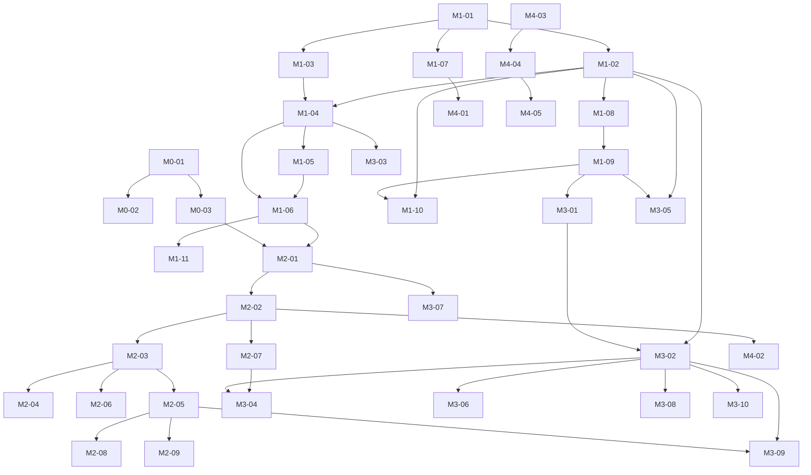

# ublue-updater — V1 Issue Breakdown

**Companion to:** [`Design.md`](Design.md) — read it first. This file decomposes V1 into implementable, ordered issues.
**How to use:** one issue ≈ one PR. Work top-to-bottom within a milestone; respect the `Depends on` fields (full graph at the bottom). Design-section references (`§`) point at `Design.md`.

**Status legend:** ☐ todo · every issue must pass its *Acceptance criteria* before merge.

---

## 0. Global engineering conventions (apply to every issue)

These are **invariants** — PRs violating them are rejected:

1. **Workspace layout:** `crates/core` (`ublue-updater-core`, no gpui dependency — hard invariant), `crates/cli` (`ublue-updater-cli`), `crates/gui` (`ublue-updater`, the app binary).
2. **Pinned UI deps:** `gpui = "=0.2.2"`, `gpui-platform-gpui-unofficial = "=1.25.2"` (or its unofficial matched set, per M0-03 outcome). No caret ranges.
3. **Child-process rules (all providers):** `LC_ALL=C`, `TZ=UTC`, `stdin = /dev/null`, watchdog timeout with "still working" state, bounded log buffer (§6).
4. **Brew env:** `HOMEBREW_NO_AUTO_UPDATE=1`, `HOMEBREW_NO_ENV_HINTS=1`, `HOMEBREW_NO_INSTALL_CLEANUP=1`.
5. **OS domain in v1 = rpm-ostree only** (unprivileged `status --json` detection, polkit-authenticated `upgrade` apply). bootc is a trait stub. No uupd anywhere.
6. **"Update everything" = sequential queue** (flatpak → distrobox → brew → OS), continue-on-error, per-domain outcomes. Never parallel fan-out.
7. **The GUI never runs as root.** No custom polkit actions, no privileged helpers.
8. **Parsing is fixture-driven:** golden files under `crates/core/tests/fixtures/`; no parser without fixture tests.
9. **CI green:** `cargo fmt --check`, `cargo clippy --workspace -- -D warnings`, `cargo test --workspace`.
10. **Out of scope for V1 (do not build):** install/remove flows, rollback UI, scheduled updates, cross-user management, telemetry, soft-restart / bootc-only warnings (v2 — §6.1).

---

## Milestone M0 — Skeleton & dependency spikes

### M0-01 · Convert repo to a Cargo workspace *(S)*
- **Design ref:** §4.2
- **Tasks:**
  - Create `[workspace]` root `Cargo.toml`; move the existing `ublue-updater` crate to `crates/gui` (bin name stays `ublue-updater`).
  - Create `crates/core` (`ublue-updater-core`) and `crates/cli` (`ublue-updater-cli`) as empty lib/bin skeletons.
  - Add a CI guard that `crates/core` never depends on gpui (simplest: grep check in CI, or `cargo tree -p ublue-updater-core | (!) grep gpui`).
- **Acceptance:**
  - ☐ `cargo build --workspace` and `cargo test --workspace` pass from a clean clone.
  - ☐ `cargo tree -p ublue-updater-core` contains no `gpui`.
  - ☐ Root `Design.md` + this file remain at repo root.

### M0-02 · CI pipeline *(S)*
- **Depends on:** M0-01
- **Tasks:** GitHub Actions on `ubuntu-latest` (or a Fedora container): fmt check, clippy `-D warnings`, tests for all three crates, `cargo doc` warnings not fatal.
- **Acceptance:**
  - ☐ A failing test in any crate fails CI.
  - ☐ CI runs on every PR and on main.

### M0-03 · gpui hello-window spike + platform-crate pairing *(M)*
- **Design ref:** §9.1, §15; Design OQ-7
- **Tasks:**
  - Add pinned deps: `gpui = "=0.2.2"` + `gpui-platform-gpui-unofficial = "=1.25.2"` (features `wayland`, `x11`, `font-kit` as needed).
  - Minimal app: open a 900×640 window titled "ublue-updater", render a placeholder `div`, quit cleanly.
  - **Spike decision:** if the unofficial platform crate does not resolve against official `gpui` 0.2.x, switch to its full unofficial matched set (`gpui_linux`, …) and record the outcome in Design.md §9.1.
- **Acceptance:**
  - ☐ Window opens and closes on Wayland **and** X11 (manual check, note results in PR).
  - ☐ Dependency set resolves with a single consistent source; decision recorded in Design.md.
  - ☐ No renderer warnings/crash on startup (blade/Vulkan init OK on dev machine).

---

## Milestone M1 — Core, headless (the real heart of V1)

### M1-01 · Domain model types *(S)*
- **Depends on:** M0-01 · **Design ref:** §5
- **Tasks:** Implement in `core`: `Domain`, `Availability`, `UpdateItem` (+ `ItemId` as a stable `String` key like `"flatpak:system:org.mozilla.firefox"`), `UpdateSet`, `TransactionEvent`, `Outcome` (incl. `Partial { failures }`), `Failure`, `ProviderError`. `serde` derives where output/tests need them.
- **Acceptance:**
  - ☐ Compiles with docs on every public type; unit tests for `Partial` aggregation helpers (if any).

### M1-02 · Process runner *(M)*
- **Depends on:** M1-01 · **Design ref:** §6 (cross-cutting rules)
- **Tasks:** One helper used by *all* providers: spawn a command with `LC_ALL=C`, `TZ=UTC`, `stdin=/dev/null`, extra env; stream stdout+stderr line-by-line into a bounded log buffer; expose a watchdog (configurable, default generous) that reports "still working" instead of silently killing; kill child process group on drop; return exit code + collected output.
- **Acceptance:**
  - ☐ Unit tests using `/bin/sh` scripts: line streaming order preserved, env vars visible to child (`sh -c 'echo $LC_ALL'`), timeout path produces "still working"/timeout event, kill-on-drop kills children.
  - ☐ No test hangs on CI (use short timeouts in tests).

### M1-03 · EventSink plumbing *(S)*
- **Depends on:** M1-01 · **Design ref:** §5
- **Tasks:** `EventSink` = bounded `async-channel` sender + helper to emit typed `TransactionEvent`s and `LogLine`s. Backpressure rule: never block the child-process reader (drop-oldest for log lines, never drop structured events).
- **Acceptance:**
  - ☐ Test proving a slow consumer can't stall the producer beyond a bounded window; structured events are never lost.

### M1-04 · `UpdateProvider` trait + registry *(S)*
- **Depends on:** M1-01, M1-03 · **Design ref:** §5
- **Tasks:** The trait exactly as designed (`detect/refresh/list_updates/apply/cancel`, async). Registry that probes the environment (tool presence) and returns the available providers in canonical order.
- **Acceptance:**
  - ☐ With no tools installed (PATH stubbed empty), registry returns zero providers and doesn't panic.
  - ☐ Trait object-safe or generic — pick one and document why.

### M1-05 · Mock provider (test support) *(M)*
- **Depends on:** M1-04 · **Design ref:** §13
- **Tasks:** Scriptable mock behind a `mock` feature of `core`: constructor takes a "script" (sequence of events/failures/delays per domain). Used by orchestrator tests now and UI tests in M2.
- **Acceptance:**
  - ☐ Can simulate: success, per-item partial failure, domain failure, slow progress, cancel.
  - ☐ Both sync (immediate) and async (timed) scripts supported.

### M1-06 · Orchestrator *(L)*
- **Depends on:** M1-04, M1-05 · **Design ref:** §5.1
- **Tasks:** Sequential queue with fixed order (Flatpak user → Flatpak system → Distrobox → Brew → OS); continue-on-error default (configurable); per-domain `Outcome` collection into a summary report; cancel = skip remaining queue + safe-stop current child (**refuse** to kill an in-flight OS transaction — surface a "cannot cancel safely" state instead); emits a global progress stream (current domain, domain-local events).
- **Acceptance:**
  - ☐ Tests (mock providers) covering: full success; one domain fails → others still run; partial outcome propagates; cancel mid-flatpak skips brew/OS; cancel during OS is refused.
  - ☐ Order is asserted in a test (no accidental parallelism — assert only one `apply` active at a time).

### M1-07 · Config load/save *(S)*
- **Depends on:** M1-01 · **Design ref:** §9.2 (settings list)
- **Tasks:** `~/.config/ublue-updater/config.toml`: per-domain enable/disable, watchdog timeout, continue-on-failure, flatpak user/system scope defaults. Load with defaults on first run; never write `/etc/uupd/*`.
- **Acceptance:**
  - ☐ Round-trip test; missing file → defaults; malformed file → defaults + warning (not a crash).

### M1-08 · Brew provider *(M)*
- **Depends on:** M1-02, M1-04 · **Design ref:** §6, §11-C3
- **Tasks:** `detect` (brew on PATH; host `~/.brew` default, cheap probe for containerized brew on custom images → set a flag that forces Brew↔Distrobox serialization in the orchestrator); `refresh` = `brew update`; `list` = `brew outdated --json=v2`; `apply` = `brew upgrade [formulae…]` with the brew env vars; coarse line-based progress.
- **Acceptance:**
  - ☐ Fixture tests for the JSON parser (see M1-09).
  - ☐ Manual run on a real Bluefin: `ublue-updater-cli list --domain brew` shows real outdated packages (PR comment with output).

### M1-09 · Parser fixtures: brew + flatpak + generic *(M)*
- **Depends on:** M1-08 · **Design ref:** §13
- **Tasks:** Create `crates/core/tests/fixtures/`; commit golden outputs: `brew-outdated-v2.json` (2–3 variants), `flatpak-remote-ls-updates.txt`, `flatpak-update-progress.txt`, `distrobox-list.txt`, `podman-ps.txt`, and the **bootc status sample from Design.md §6.1** (stored as `bootc-status.json`, reserved for the v2 path — not parsed in v1).
- **Acceptance:**
  - ☐ Every parser in v1 has at least one happy-path and one edge fixture (empty output, malformed line).
  - ☐ Fixtures are committed, not generated at test time.

### M1-10 · Flatpak provider *(L)*
- **Depends on:** M1-02, M1-04, M1-09 · **Design ref:** §6, §11-D3/D4
- **Tasks:** `detect`; `list` = `flatpak remote-ls --updates` for **both** `--user` and `--system` (item ids scoped by installation, sizes when reported); `apply` = targeted `flatpak update --noninteractive --assumeyes [--user|--system] <refs…>` so failures are item-scoped; parse `Installing x/y` → percent; map common per-ref failures (EOL runtime, app running) to `Partial`.
- **Acceptance:**
  - ☐ Fixture tests for list + progress parsing.
  - ☐ Failure-mapping table (raw output → `Failure.reason`) covered by tests with synthetic outputs.
  - ☐ Manual: user+system scopes both listed on a real host (PR comment).

### M1-11 · CLI debug binary *(S)*
- **Depends on:** M1-06, M1-07, M1-08, M1-10 · **Design ref:** §4.2, §13
- **Tasks:** `ublue-updater-cli` with subcommands: `detect`, `list [--domain X] [--json]`, `apply [--domain X]`, `cancel`. Human output default, `--json` for scripting. This is the M1–M3 validation vehicle on real machines.
- **Acceptance:**
  - ☐ `detect` prints one line per domain with availability.
  - ☐ `list`/`apply` usable on a real Bluefin without the GUI.

---

## Milestone M2 — GUI panel (gpui), driven by mock providers

### M2-01 · App bootstrap & event draining *(M)*
- **Depends on:** M0-03, M1-06 · **Design ref:** §9.3
- **Tasks:** Replace the hello-window spike with the real shell: root `UpdaterPanel` entity; construction wires the provider registry (mock when `--mock` flag or `debug_assertions` + no tools); drain `EventSink` via `cx.spawn` in batches (e.g. flush every event loop tick) → `cx.notify()`. Never block render on I/O.
- **Acceptance:**
  - ☐ App runs with mock providers and shows the four sections (from registry) without touching the real system in test mode.
  - ☐ No UI stall when a mock floods 10k log lines (batching works).

### M2-02 · Theme + primitives *(M)*
- **Depends on:** M2-01 · **Design ref:** §9.2
- **Tasks:** Design tokens (dark-first, one accent, spacing/type scale); reusable views: primary/secondary/danger **button**, **checkbox + tri-state select-all**, **count badge**, **progress bar** (determinate + indeterminate "still working" pulse), **collapsible section header**, **banner**. Keep primitives dumb (props in, callbacks out) for `#[gpui::test]`-ability.
- **Acceptance:**
  - ☐ Each primitive renders in isolation in a test; hover/pressed/disabled states present on buttons.

### M2-03 · Domain section component *(M)*
- **Depends on:** M2-02 · **Design ref:** §9.2
- **Tasks:** One parameterized section view: header (icon, domain name, count badge, scope hint "user/system" or "per-user"), expand/collapse, per-domain **Update** button, and the state machine `Idle / Refreshing / Listing / Applying / Done / Partial / Failed`. `Partial` must render the failing items inline with reasons.
- **Acceptance:**
  - ☐ `#[gpui::test]`: all seven states render via a mock; clicking Update in `Idle` issues the apply command.

### M2-04 · Item list + selection *(M)*
- **Depends on:** M2-03 · **Design ref:** §9.2
- **Tasks:** `UniformList` virtualized item rows: checkbox, name, current → target, size (or "unknown"), pinned/disabled rows unselectable. Selection state per section; tri-state "select all" in the header.
- **Acceptance:**
  - ☐ Perf smoke: 500 mock items render/scroll without frame drops (manual or test-measured).
  - ☐ Select-all toggles correctly with mixed pinned items.

### M2-05 · "Update everything" flow *(M)*
- **Depends on:** M2-03, M1-06 · **Design ref:** §5.1, §9.2
- **Tasks:** Confirm dialog → run orchestrator queue with all selected items; global progress row (current domain, percent if any, **Cancel**); summary report when finished (per-domain outcome chips; failures link to their sections). Continue-on-failure is the default and must be visible in the copy ("other domains still updated").
- **Acceptance:**
  - ☐ Mock run: one domain fails mid-queue, remaining domains still execute, summary shows all four outcomes.
  - ☐ Cancel during flatpak skips remaining queue; cancel during OS shows "cannot cancel safely" (per M1-06).

### M2-06 · Log drawer *(M)*
- **Depends on:** M2-03 · **Design ref:** §9.2
- **Tasks:** Collapsible bottom drawer: per-section tabs, timestamped raw lines from the bounded buffer, **copy-all** button (support artifact). Virtualized or windowed rendering.
- **Acceptance:**
  - ☐ Copy button puts the section's full log on the clipboard (mock test).
  - ☐ Drawer open during a flood of log lines stays responsive.

### M2-07 · Banners *(S)*
- **Depends on:** M2-02 · **Design ref:** §9.2
- **Tasks:** Banner component: restart-required (with **Restart** action — hidden until M3-04 wires the real signal), generic warning, generic error. Dismissible where appropriate; restart-required is sticky.
- **Acceptance:**
  - ☐ All three banner types render in tests; sticky behavior asserted.

### M2-08 · Keyboard & focus baseline *(M)*
- **Depends on:** M2-03, M2-05 · **Design ref:** §9.2
- **Tasks:** gpui `actions!` + keybindings: `R` refresh, `U`/`⌘U` update-all, `Space` toggle selection, `L` logs, `Esc` cancel/close-dialog. Logical focus order across sections; every interaction reachable without a mouse.
- **Acceptance:**
  - ☐ Manual checklist in PR: full list → select → update-all → cancel achievable keyboard-only.

### M2-09 · Mock-driven UI test suite *(M)*
- **Depends on:** M2-01..M2-07 · **Design ref:** §13
- **Tasks:** Consolidate the per-issue `#[gpui::test]`s into a scenario suite: happy path, partial failure, domain failure, cancel, restart banner, offline domain error. Runs in CI (no real subprocesses).
- **Acceptance:**
  - ☐ Suite green in CI; a deliberately broken mock (event never arrives) fails the suite (sanity check).

---

## Milestone M3 — OS + distrobox + hardening (real system)

### M3-01 · rpm-ostree status fixture + parser *(M)*
- **Depends on:** M1-09 · **Design ref:** §6.1
- **Tasks:** On a real Bluefin host, capture `rpm-ostree status --json` in at least three states (up-to-date, update available/cached, staged) → fixtures. Implement the parser: booted deployment, staged deployment (restart-required signal), `cached-update` payload (update available), rollback deployment. Exact key names pinned from the fixtures (schema varies across rpm-ostree versions — parse defensively).
- **Acceptance:**
  - ☐ All three fixtures parse to the expected model; unknown-key tolerance test (future schema drift doesn't panic).

### M3-02 · OS provider (rpm-ostree) *(L)*
- **Depends on:** M3-01, M1-02, M1-04 · **Design ref:** §6, §7 (D6)
- **Tasks:** `detect`; `refresh` = `rpm-ostree refresh-md`; `list` from status JSON (staged → "restart required", not a fake update item; `cached-update` → update item); `apply` = `rpm-ostree upgrade` (polkit — the **only** apply path; never sudo, never bootc). Progress from pull/deploy lines; **"Waiting for authentication…"** state when the child goes quiet pre-auth (watchdog must not kill it — Design §11-A3); error mapping: lock busy, no polkit agent, staged/nothing-to-do.
- **Acceptance:**
  - ☐ Fixture-driven tests for list + progress + the three error mappings.
  - ☐ Manual on real host: apply triggers the polkit prompt via the session agent; staged deployment appears after; banner shows.

### M3-03 · bootc trait stub *(S)*
- **Depends on:** M1-04 · **Design ref:** §6.1, §12 (M3)
- **Tasks:** Second `OsProvider` impl returning `Availability::Absent`-style "not supported in v1" (bootc requires root for everything — Design OQ-6). Exists to keep the trait honest and to reserve the v2 authenticated-enrichment path; document it in-code.
- **Acceptance:**
  - ☐ Registry selects rpm-ostree even on bootc-managed hosts; stub is never constructed in v1.

### M3-04 · Restart-required banner wiring + Reboot action *(S)*
- **Depends on:** M3-02, M2-07 · **Design ref:** §9.2, §7
- **Tasks:** Show the sticky banner when the OS provider reports a staged deployment; **Restart** button → `systemctl reboot` (agent prompts if required). No soft-restart in v1.
- **Acceptance:**
  - ☐ Test: staged state → banner visible + Restart action wired; after (mocked) reboot trigger, state resets on next detect.

### M3-05 · Distrobox provider *(M)*
- **Depends on:** M1-02, M1-04, M1-09 · **Design ref:** §6, §11-D7/B4
- **Tasks:** `detect` (distrobox + podman|docker in PATH; docker-backend without group access → `Broken`); `list` = container names + running/stopped state (from `distrobox list`/`podman ps` — fixtures); **no fake update counts** — D7 UX: items show state and "check = pull" affordance; `apply` = `distrobox upgrade --all` or per-container `-n <name>`; warn before upgrading *running* containers.
- **Acceptance:**
  - ☐ Fixture tests for container listing.
  - ☐ UI copy in tests asserts no fabricated "N updates" badge for distrobox (D7 honesty rule).

### M3-06 · Preflight coordination (locks & foreign automation) *(M)*
- **Depends on:** M3-02, M1-11 · **Design ref:** §8, §11-B1/B2
- **Tasks:** Before any apply: query systemd via **zbus** `ListUnits` for active `uupd.service` / legacy `ublue-update.service` (only where installed); read rpm-ostreed's `AutomaticUpdatePolicy`. If a foreign update is running: "Updates are already running (source)" state with retry. Treat rpm-ostree transaction-lock errors as retryable with a friendly message.
- **Acceptance:**
  - ☐ Unit tests with a mocked zbus reply; manual drill: start `uupd` (or fake unit) → apply blocked with the right message.

### M3-07 · Single-instance lock *(S)*
- **Depends on:** M2-01 · **Design ref:** §8
- **Tasks:** `fd-lock` on `~/.local/state/ublue-updater/lock`; second launch surfaces a notice and exits (v1: no window-activation magic required).
- **Acceptance:**
  - ☐ Two simultaneous launches: exactly one runs, the second exits cleanly with a message.

### M3-08 · logind inhibit during apply *(S)*
- **Depends on:** M3-02 · **Design ref:** §8
- **Tasks:** Acquire `shutdown:sleep` inhibit ("Updates in progress") for the duration of any apply; release on finish/cancel. `systemd-inhibit` child or zbus — pick one, document.
- **Acceptance:**
  - ☐ Inhibit visible in `systemd-inhibit --list` while a (mock) apply runs; gone after.

### M3-09 · Close-protection + cancel semantics finalization *(S)*
- **Depends on:** M2-05, M3-02 · **Design ref:** §8, §11-E5/E6
- **Tasks:** Warn-on-close while a transaction is active ("flatpak/brew will be killed; OS staging is safe"); confirm dialog for cancelling; refuse mid-OS cancel (already M1-06 — verify end-to-end through the GUI).
- **Acceptance:**
  - ☐ GUI test: close during active mock apply shows the warning; proceeding kills children (log proves it).

### M3-10 · Error-mapping table *(M)*
- **Depends on:** M1-08, M1-10, M3-02, M3-05 · **Design ref:** §9.2, §11
- **Tasks:** Central map: raw provider failures → human strings for the 10 most common cases (lock busy, no auth agent, offline, disk full, EOL runtime, app running, incompatible image, staged/nothing, brew fetch failure, podman denied). Each maps to actionable copy; unknown errors fall back to "see logs" + open drawer.
- **Acceptance:**
  - ☐ Table covered by tests (raw string in → message out); unknown error path opens the log drawer in a UI test.

---

## Milestone M4 — Polish & distribution

### M4-01 · Settings view *(M)*
- **Depends on:** M1-07, M2-03 · **Design ref:** §9.2
- **Tasks:** Settings screen bound to the config toml: domain toggles, watchdog timeout, continue-on-failure, flatpak scope defaults. Read-only awareness of `/etc/uupd/config.json` (warn about conflicting automation only — never write it).
- **Acceptance:**
  - ☐ Edits persist and take effect on next refresh/apply; config round-trip tested.

### M4-02 · i18n scaffolding *(S)*
- **Depends on:** M2-02 · **Design ref:** §9.2
- **Tasks:** Route every user-facing string through a `tr()` indirection (Fluent or a thin wrapper — English-only content in v1). Child-process parsing stays `LC_ALL=C` regardless of UI locale.
- **Acceptance:**
  - ☐ Grep finds no hard-coded UI strings outside the `tr()` layer; a test swaps one string to prove the indirection works.

### M4-03 · Assets: icon, desktop file, metainfo *(S)*
- **Tasks:** App icon (SVG + PNG sizes), `ublue-updater.desktop`, AppStream metainfo with release notes.
- **Acceptance:** ☐ `desktop-file-validate` and `appstreamcli validate` pass.

### M4-04 · RPM packaging + COPR *(M)*
- **Depends on:** M4-03 · **Design ref:** §11-G1
- **Tasks:** RPM spec: runtime deps `vulkan-loader`, `mesa-vulkan-drivers` (or `lavapipe`), `fontconfig`, Wayland/X11 client libs; build via COPR (`ublue-os/packages` channel or project repo). **Not a Flatpak.**
- **Acceptance:**
  - ☐ `rpm -qp --requires` contains the GPU/font deps.
  - ☐ Installs and launches on a stock Bluefin VM via COPR.

### M4-05 · VM smoke test (GPU/Vulkan) *(S)*
- **Depends on:** M4-04 · **Design ref:** §11-C5
- **Tasks:** Nightly/manual script: launch the app in a Bluefin VM (lavapipe software Vulkan); verify window renders and a clear error appears if no Vulkan device (test by masking).
- **Acceptance:** ☐ Documented pass/fail checklist committed; failure mode message verified.

### M4-06 · Spike (report-only): systemd-run survivability *(S, optional)*
- **Design ref:** §8, §11-E6 — Long transactions spawned as `systemd-run --user` transient units survive app close. **v1 ships the report, not the behavior.**
- **Acceptance:** ☐ Short doc in the repo: feasibility, trade-offs, proposed UX.

### M4-07 · Spike (report-only): DBus progress for rpm-ostree/flatpak *(S, optional)*
- **Design ref:** §4.2 (D2 phase 2) — zbus transaction `Progress` signals for real percentages.
- **Acceptance:** ☐ Short doc: API surface found, prototype notes, effort estimate.

### M4-08 · README + support docs *(S)*
- **Tasks:** Positioning vs uupd (GUI panel, not a scheduler; polkit path — no sudoers), manual test checklist (§13 error-path drills), bug-report instructions ("copy log"), known limitations (agent-less WMs, no rollback UI, per-user brew/distrobox scope).
- **Acceptance:** ☐ A new contributor can build, run, and validate from the README alone.

---

## Dependency graph

## Suggested linear order (when in doubt)

`M0-01 → M0-02 → M0-03 → M1-01 → M1-02 → M1-03 → M1-04 → M1-05 → M1-06 → M1-07 → M1-08 → M1-09 → M1-10 → M1-11 → M2-01 → M2-02 → M2-03 → M2-04 → M2-05 → M2-06 → M2-07 → M2-08 → M2-09 → M3-01 → M3-02 → M3-03 → M3-04 → M3-05 → M3-06 → M3-07 → M3-08 → M3-09 → M3-10 → M4-01 → M4-02 → M4-03 → M4-04 → M4-05 → M4-08 → (M4-06/M4-07 optional)`

## Milestone exit criteria (from Design §12)

| Milestone | Done when |
|---|---|
| M0 | Window opens on Wayland + X11; platform-crate pairing settled; CI green |
| M1 | `ublue-updater-cli list/apply` works on a real Bluefin for brew + flatpak; fixtures green |
| M2 | Full happy path + failure paths pass in `#[gpui::test]` on mock system in CI |
| M3 | All four domains live on a real Bluefin; A/B/E edge-case matrix items handled |
| M4 | Installable RPM on stock Bluefin; error paths human-readable; docs complete |

**Total: 41 issues** (39 required + 2 optional report-only spikes: M4-06, M4-07).
